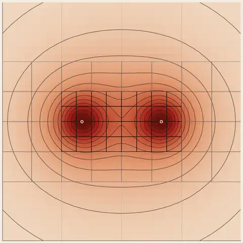
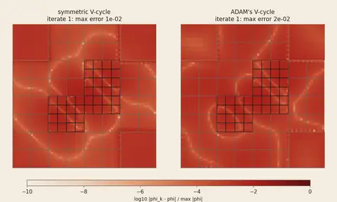
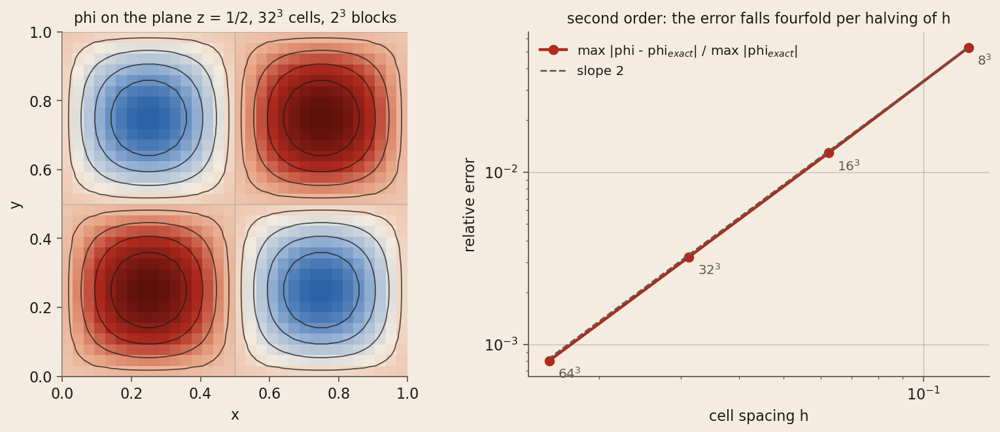
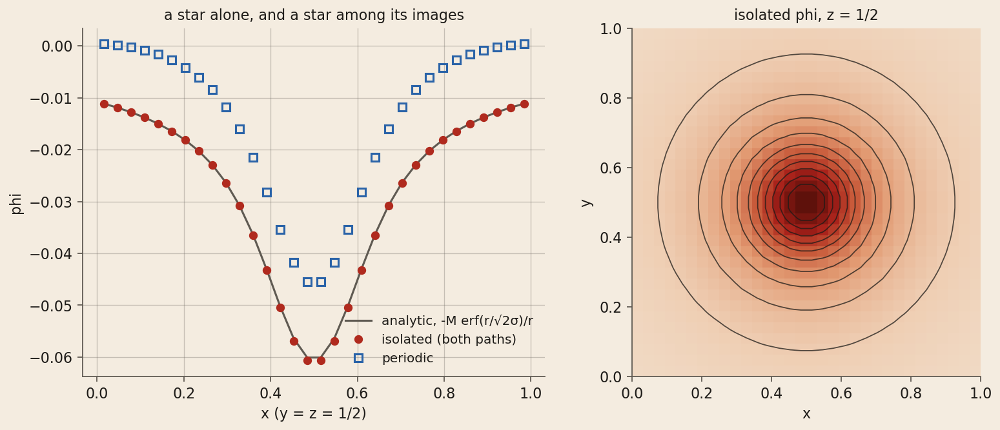
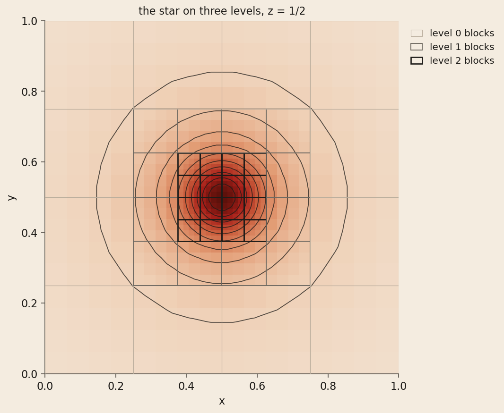
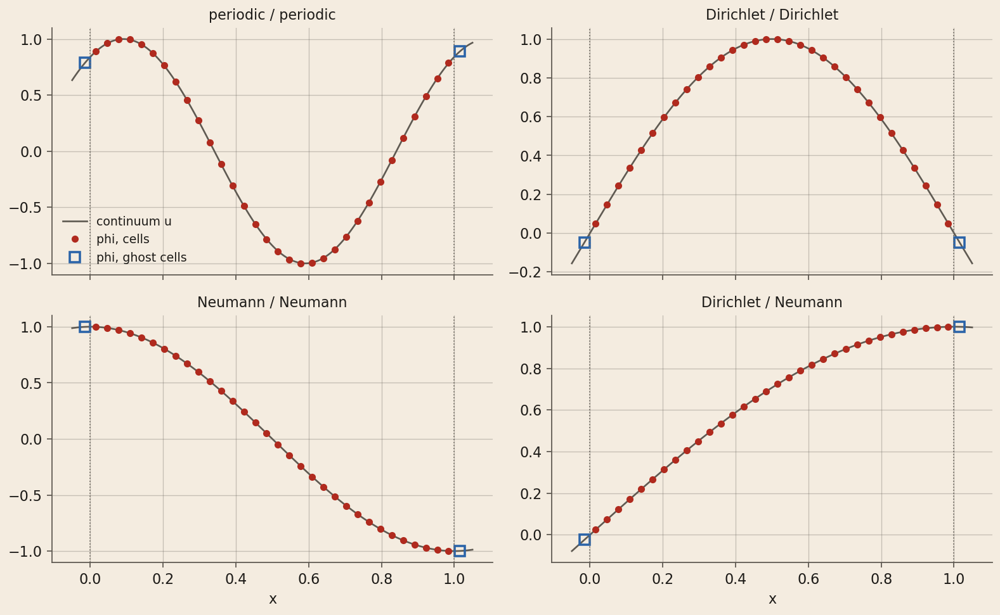

<div align="center">

<picture>
  <source media="(prefers-color-scheme: dark)"  srcset="docs/public/logo-dark.svg">
  <source media="(prefers-color-scheme: light)" srcset="docs/public/logo.svg">
  
</picture>

#### *FFT and AMR multigrid Poisson solvers, two solvers behind one facade, on every rank and GPU*

### **E**lliptic **L**aplacian **I**nversion, **S**pectral and **H**ierarchical **A**lgorithms

> The elliptic solvers of ADAM, pulled out into a library of their own. Elisha asked Elijah for a double portion of
> his spirit and took up his mantle (2 Kings 2:9–13); ELISHA took up FLAIL's, kept it bitwise, and fixed the one
> thing its master got wrong.

[](https://github.com/szaghi/ELISHA/releases)
[](https://github.com/szaghi/ELISHA/actions/workflows/ci.yml)
[](https://github.com/szaghi/ELISHA/actions/workflows/matrix.yml)
[](https://fortran-lang.org/)
[](LICENSE.gpl3.md)
[](LICENSE.bsd-2.md)
[](LICENSE.bsd-3.md)
[](LICENSE.mit.md)

<p>
<a href="https://szaghi.github.io/ELISHA/tutorial/08-embers"><picture><source media="(prefers-color-scheme: dark)" srcset="docs/public/tutorial/casts/t08-embers-dark.webp"></picture></a>
<a href="https://szaghi.github.io/ELISHA/tutorial/06-iterations"><picture><source media="(prefers-color-scheme: dark)" srcset="docs/public/tutorial/casts/t06-iterates-dark.webp"></picture></a>
</p>
<p><sub><i>Left: two embers in free space, the mesh refined around them at every step. Right: the error of each FCG
iterate on an AMR mesh, the symmetric V-cycle against ADAM's, 12 iterations against 19.</i></sub></p>
<p>
<a href="https://szaghi.github.io/ELISHA/tutorial/01-box"><picture><source media="(prefers-color-scheme: dark)" srcset="docs/public/tutorial/t01-box-dark.png"></picture></a>
<a href="https://szaghi.github.io/ELISHA/tutorial/03-isolated"><picture><source media="(prefers-color-scheme: dark)" srcset="docs/public/tutorial/t03-isolated-dark.png"></picture></a>
<br>
<a href="https://szaghi.github.io/ELISHA/tutorial/04-amr"><picture><source media="(prefers-color-scheme: dark)" srcset="docs/public/tutorial/t04-amr-dark.png"></picture></a>
<a href="https://szaghi.github.io/ELISHA/tutorial/02-faces"><picture><source media="(prefers-color-scheme: dark)" srcset="docs/public/tutorial/t02-faces-dark.png"></picture></a>
</p>

<div>
<table>
<tr>
<td><b>🔥 Spectral, to round-off</b><br><sub>A direct FFT solver on uniform block lattices: periodic, Dirichlet and Neumann faces by odd and even extensions, or isolated by Hockney and Eastwood with the lattice Green's function. It divides by the eigenvalues of the discrete Laplacian, so what it returns solves the discrete equation to round-off. <a href="https://szaghi.github.io/ELISHA/tutorial/01-box">A periodic box</a> · <a href="https://szaghi.github.io/ELISHA/reference/spectral">Spectral solver</a></sub></td>
<td><b>🌳 Hierarchical, on 2:1 octrees</b><br><sub>Flexible conjugate gradients preconditioned by a multigrid V-cycle on 2:1-balanced octrees of blocks, the FFT solver at its root; free space by the James step; inhomogeneous boundary values. Its V-cycle is symmetric, which ADAM's was not: it converges where ADAM's stalled, in 24 to 30% less time. <a href="https://szaghi.github.io/ELISHA/tutorial/04-amr">Refine where it matters</a> · <a href="https://szaghi.github.io/ELISHA/tutorial/06-iterations">Watching the FCG</a></sub></td>
</tr>
<tr>
<td><b>🌌 Stars in empty space</b><br><sub>Isolated boundaries on both paths, which agree with each other to 1e-10 and with the analytic potential of a Gaussian star to the discretisation; the binding energy from the solver's energy. <a href="https://szaghi.github.io/ELISHA/tutorial/03-isolated">A star in empty space</a> · <a href="https://szaghi.github.io/ELISHA/cookbook/gravity">Self-gravity</a></sub></td>
<td><b>🙏 Refuses politely</b><br><sub>A mesh that is not 2:1, faces that do not pair, a solve that does not converge: each comes back as one of 36 named status codes with a message, the same on every rank. The library never stops your program, and a solve that did not converge still hands back its last iterate. <a href="https://szaghi.github.io/ELISHA/cookbook/faces">Which faces go together</a> · <a href="https://szaghi.github.io/ELISHA/reference/status">Status codes</a></sub></td>
</tr>
<tr>
<td><b>⚡ Many ranks, many GPUs</b><br><sub>Any MPI communicator, or none (the serial build); FFTW on the host, cuFFT and OpenACC on NVIDIA GPUs, with your arrays on the device if you like, bitwise the same. On an A30 the multigrid takes 17 to 37% less time than ADAM's GPU code, and solves a 3.9 M-cell AMR problem in half the time of 64 CPU cores. <a href="https://szaghi.github.io/ELISHA/tutorial/09-gpu">On the GPU</a> · <a href="https://szaghi.github.io/ELISHA/guide/performance">Performance</a></sub></td>
<td><b>🔬 Verification you can rerun</b><br><sub>Bitwise to ADAM's code on 1 to 3 ranks with gfortran, nvfortran and ifx, and on an A30; the physics against analytic solutions; scaling ladders to 64 CPU ranks and 4 A30s; every number in the documentation printed by a program that CI compiles and runs. <a href="https://szaghi.github.io/ELISHA/verification/">Verification</a></sub></td>
</tr>
</table>
</div>

**[Full documentation](https://szaghi.github.io/ELISHA/)**: [start](https://szaghi.github.io/ELISHA/guide/) · [tutorial](https://szaghi.github.io/ELISHA/tutorial/) · [cookbook](https://szaghi.github.io/ELISHA/cookbook/) · [reference](https://szaghi.github.io/ELISHA/reference/) · [verification](https://szaghi.github.io/ELISHA/verification/) · [API](https://szaghi.github.io/ELISHA/api/)

</div>

---

## Quick start

```bash
git clone https://github.com/szaghi/ELISHA && cd ELISHA
fobis fetch                                               # PENF (and GIDEON, for one test)
fobis build --mode static-gnu                             # lib/gnu/static/libelisha.a, MPI
fobis build --mode tests-gnu && bash scripts/run_tests.sh # the test programs, MPI ones on 2 ranks
```

or the one-line installer (the serial library, under `~/.local`):

```bash
curl -fsSL https://github.com/szaghi/ELISHA/releases/latest/download/install.sh | bash -s -- --gnu
```

as a FoBiS dependency, in the `fobos` of your project (then `fobis fetch && fobis build`):

```ini
[dependencies]
deps_dir = src/third_party
PENF     = https://github.com/szaghi/PENF :: branch=master   # ELISHA's own dependency: fobis fetch is not transitive
ELISHA   = https://github.com/szaghi/ELISHA :: branch=main
```

or as an fpm dependency (the serial build), in your `fpm.toml`:

```toml
[dependencies]
ELISHA = { git = "https://github.com/szaghi/ELISHA", branch = "main" }
```

Describe your blocks, give the solver your communicator, solve; the path (spectral on one level, hierarchical on 2:1
AMR) is chosen for the mesh:

```fortran
use elisha
type(elisha_comm_object)   :: comm
type(elisha_mesh_object)   :: mesh
type(elisha_solver_object) :: solver

call comm%init(MPI_COMM_WORLD, stat, errmsg)                 ! ELISHA works on its own duplicate
call mesh%init(nijk, ngc, nblk0, dx0, emin, periodic, null, coords, stat, errmsg) ! this rank's blocks
call solver%setup(mesh, comm, stat, errmsg)                  ! one level: spectral; 2:1 AMR: hierarchical
call solver%solve_packed(mesh, f, factor, phi, stat, errmsg) ! L_h phi = factor (f - mean f), ghosts filled
```

The [tutorial](https://szaghi.github.io/ELISHA/tutorial/) goes from one periodic box to two embers orbiting on an
adaptive mesh and onto the GPU; the [reference](https://szaghi.github.io/ELISHA/reference/) lists every argument,
kind and status code.

## Authors

**[Stefano Zaghi](https://github.com/szaghi)** · stefano.zaghi@gmail.com
> *Chief Yak Shaver & Inheritor of Mantles* — wrote FLAIL inside ADAM, then pulled it out again as its own library,
> because the fourth extraction of a monorepo is when you finally get the naming right

**[Claude](https://claude.ai)** (Anthropic)
> *Tireless Rubber Duck & Professional Ghost Filler* — AI pair programmer; fills the ghost layers so humans don't
> have to, found the V-cycle that was not symmetric, and has mentioned it ever since

## License

ELISHA is available under your choice of license:

| License | SPDX | File |
|---|---|---|
| GNU General Public License v3 | `GPL-3.0-or-later` | [LICENSE.gpl3.md](LICENSE.gpl3.md) |
| BSD 2-Clause | `BSD-2-Clause` | [LICENSE.bsd-2.md](LICENSE.bsd-2.md) |
| BSD 3-Clause | `BSD-3-Clause` | [LICENSE.bsd-3.md](LICENSE.bsd-3.md) |
| MIT | `MIT` | [LICENSE.mit.md](LICENSE.mit.md) |

© [Stefano Zaghi](https://github.com/szaghi)
