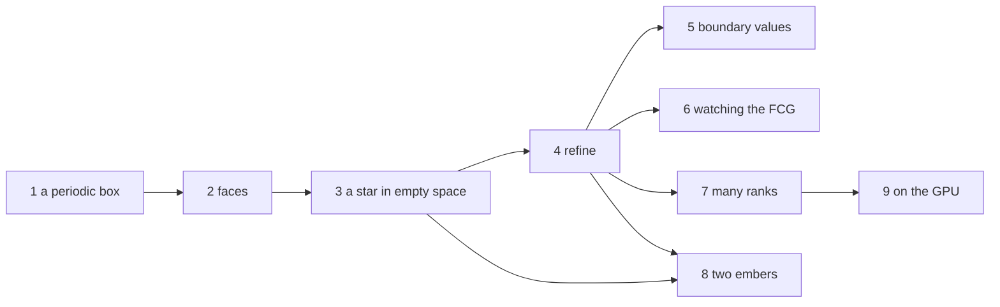

# Tutorial

Nine chapters, from one periodic box to two embers orbiting on an adaptive mesh and onto the GPU. Each chapter is a
complete program in `docs/examples/src/`. The code on these pages is that program, and the output is what it printed
when the documentation was built: `bash scripts/docs_examples.sh` regenerates both, and CI fails when they drift.
The figures and animations are drawn from the same programs (`bash scripts/docs_figures.sh`).

<div class="elisha-casts">
<figure class="elisha-cast" style="--ar: 1.0">
<video class="light-only" autoplay loop muted playsinline poster="/tutorial/casts/t08-embers-light.png" aria-label="Two embers orbiting on an adaptive mesh"><source src="/tutorial/casts/t08-embers-light.webm" type="video/webm"><source src="/tutorial/casts/t08-embers-light.mp4" type="video/mp4"></video>
<video class="dark-only" autoplay loop muted playsinline poster="/tutorial/casts/t08-embers-dark.png" aria-label="Two embers orbiting on an adaptive mesh"><source src="/tutorial/casts/t08-embers-dark.webm" type="video/webm"><source src="/tutorial/casts/t08-embers-dark.mp4" type="video/mp4"></video>
<figcaption><a href="./08-embers">Chapter 8</a>: two embers in free space, the mesh refined around them at every
step, one isolated hierarchical solve per frame.</figcaption>
</figure>
<figure class="elisha-cast" style="--ar: 1.67">
<video class="light-only" autoplay loop muted playsinline poster="/tutorial/casts/t06-iterates-light.png" aria-label="The error of the FCG iterates, both V-cycles"><source src="/tutorial/casts/t06-iterates-light.webm" type="video/webm"><source src="/tutorial/casts/t06-iterates-light.mp4" type="video/mp4"></video>
<video class="dark-only" autoplay loop muted playsinline poster="/tutorial/casts/t06-iterates-dark.png" aria-label="The error of the FCG iterates, both V-cycles"><source src="/tutorial/casts/t06-iterates-dark.webm" type="video/webm"><source src="/tutorial/casts/t06-iterates-dark.mp4" type="video/mp4"></video>
<figcaption><a href="./06-iterations">Chapter 6</a>: the error of each FCG iterate on an AMR mesh, the symmetric
V-cycle against ADAM's: 12 iterations against 19.</figcaption>
</figure>
</div>



| Chapter | You learn |
|---|---|
| [1. A periodic box](/tutorial/01-box) | the three objects (communicator, mesh, solver), the packed source, the ghost layers; second order |
| [2. Faces](/tutorial/02-faces) | periodic, Dirichlet and Neumann faces, null axes, and what each kind writes into the ghost cell |
| [3. A star in empty space](/tutorial/03-isolated) | isolated boundaries on both paths, and why a periodic box is the wrong place for a star |
| [4. Refine where it matters](/tutorial/04-amr) | a 2:1 AMR mesh, the hierarchical path, and the two refusals a careless refinement earns |
| [5. Boundary values](/tutorial/05-values) | inhomogeneous Dirichlet faces: `boundary_faces`, then `ghost` |
| [6. Watching the FCG](/tutorial/06-iterations) | `max_iterations`, `ELISHA_ERR_NOT_CONVERGED`, and the symmetric V-cycle against ADAM's |
| [7. Many ranks](/tutorial/07-mpi) | one source, serial or MPI; each rank its own blocks; what is bitwise across rank counts and what is not |
| [8. Two embers](/tutorial/08-embers) | a regrid per step: a new mesh, a new setup |
| [9. On the GPU](/tutorial/09-gpu) | the device backends by mold, and the device-resident arrays (`on_device`) |

## Building the examples

Every program is compiled the way your own program would be, against the static library FoBiS builds. The serial
library (no MPI, `-DELISHA_NO_MPI`) needs nothing but FFTW:

```bash
fobis fetch                              # PENF into src/third_party
fobis build --mode static-gnu-serial     # lib/gnu/static-serial/libelisha_serial.a and its modules
L=lib/gnu/static-serial
gfortran -cpp -DELISHA_NO_MPI -I$L/mod docs/examples/src/t01_box.F90 $L/libelisha_serial.a -lfftw3 -o t01_box
./t01_box
```

Chapters 7 and 9 also run under MPI (`fobis build --mode static-gnu`, then `mpifort` without `-DELISHA_NO_MPI`), and
chapter 9 on a GPU with the device library (`static-nvf-oac`); their MPI and GPU outputs were captured by hand and
are kept in `docs/examples/mpi/` and `docs/examples/device/`.
